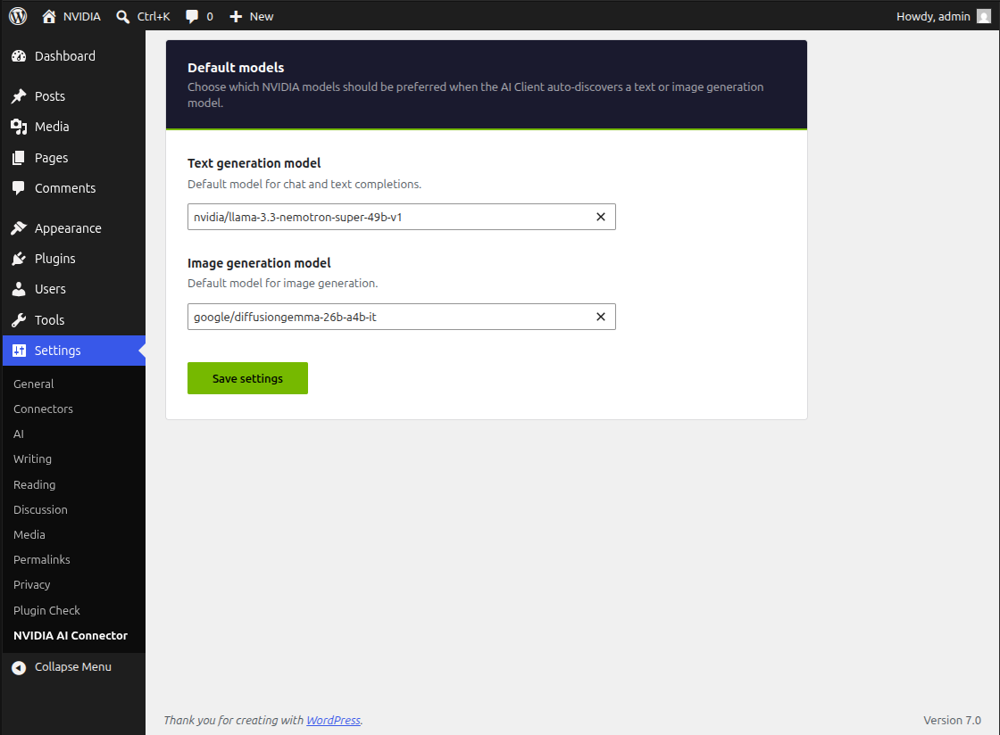

# Forgeia AI Provider for NVIDIA

Forgeia AI Provider for NVIDIA for the [PHP AI Client](https://github.com/wordpress/php-ai-client) SDK. Works as both a Composer package and a WordPress plugin.

## Requirements

- PHP 7.4 or higher
- When using with WordPress, requires WordPress 6.9 or higher with the [wordpress/php-ai-client](https://github.com/wordpress/php-ai-client) plugin installed, or WordPress 7.0 or higher, which bundles the AI Client SDK
- Embedding generation requires AI Client 1.4 or higher. WordPress 7.0 and 7.1 bundle AI Client 1.3.1, which does not include embedding support.

## Installation

### As a Composer Package

```
composer require forgeia/forgeia-ai-provider-for-nvidia
```

### As a WordPress Plugin

1. Download the plugin files
2. Upload to `/wp-content/plugins/forgeia-ai-provider-for-nvidia/`
3. Ensure the PHP AI Client plugin is installed and activated
4. Activate the plugin through the WordPress admin

## Usage

### With WordPress

The provider automatically registers itself with the PHP AI Client on the `init` hook. Simply ensure both plugins are active and configure your API key:

```php
// Set your NVIDIA API key (or use the NVIDIA_API_KEY environment variable)
putenv('NVIDIA_API_KEY=your-api-key');

// Use the provider
$result = AiClient::prompt('Hello, world!')
    ->usingProvider('nvidia')
    ->generateTextResult();
```

### As a Standalone Package

```php
use WordPress\AiClient\AiClient;
use Forgeia\NvidiaAiProvider\Provider\NvidiaProvider;

// Register the provider
$registry = AiClient::defaultRegistry();
$registry->registerProvider(NvidiaProvider::class);

// Set your API key
putenv('NVIDIA_API_KEY=your-api-key');

// Generate text
$result = AiClient::prompt('Explain quantum computing')
    ->usingProvider('nvidia')
    ->generateTextResult();

echo $result->toText();
```



## Supported Models

Available models are dynamically discovered from the NVIDIA NIM API and classified by capability using explicit allowlists. This includes text generation models (NVIDIA Nemotron 3 and 3.5, Meta Llama, Google Gemma 3 and 4, Mistral Large 4, Moonshot Kimi K2.6, Muse Glimmer, Step 5, GLM 5.3, and others), vision / multimodal models that accept images (including Gemma 3 and 4, Kimi K2.6, Muse Glimmer, Step 5, Mistral Large 4, GLM 5.3, NVIDIA NeVA, and NVIDIA VILA), image generation (DiffusionGemma), and embedding models (Nemotron 3.5 Embed, NVCLIP, NV-EmbedQA, Arctic Embed). Embedding generation requires AI Client 1.4+ and is unavailable on WordPress 7.0/7.1, which bundle AI Client 1.3.1. See the [NVIDIA Build](https://build.nvidia.com/) for the full list of available models.

## Configuration

The provider uses the `NVIDIA_API_KEY` environment variable for authentication. You can set this in your environment or via PHP:

```php
putenv('NVIDIA_API_KEY=your-api-key');
```

## License

GPL-2.0-or-later
